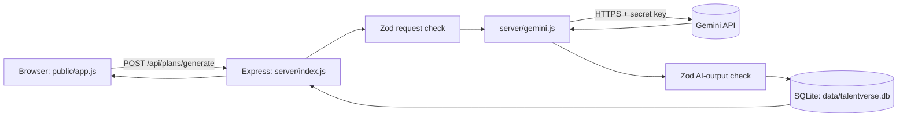

# Viva Preparation — TalentVerse AI

## A. Introduction
TalentVerse AI turns a student's plain-English career goal and skills into a structured roadmap. Gemini generates the data, the server checks it, SQLite stores it, and the website shows it and tracks progress.

## B. Problem and objectives
Students know where they want to go but not what they are missing. Objectives: (1) accept natural language, (2) get structured output from a generative model, (3) never trust that output without validation, (4) store it permanently, (5) keep the API key secret.

## C. Technologies and why
- **Express (Node.js):** small, easy web server and API.
- **SQLite (better-sqlite3):** a database in one file, no installation or account.
- **Gemini API:** the generative AI model; supports JSON-schema output.
- **Zod:** checks data shape at run time (TypeScript types vanish at run time, Zod does not).
- **Plain HTML/CSS/JS:** no build step, so it runs after `npm install`.

## D. Architecture

## E. Workflow (what really happens)
1. `studio()` in `public/app.js` collects the form and calls `api("/plans/generate", {method:"POST"})`.
2. `server/index.js` route `POST /api/plans/generate` validates the body with `requestSchema`.
3. `generatePlan()` in `server/gemini.js` builds a prompt and calls `callGemini()`.
4. Gemini returns JSON text (we asked with `responseMimeType: "application/json"` plus a `responseSchema`).
5. `JSON.parse` then `aiOutputSchema.safeParse` (Zod). If it fails, one retry that tells the model what was wrong. If it fails again: HTTP 502.
6. `insertPlan()` in `server/db.js` runs an INSERT. Only if that works does the server answer 201 with the saved row.
7. The browser navigates to `#/plan/<id>` and `planDetail()` loads the plan from `GET /api/plans/:id`.

## F. Frontend
- Pages are functions in `public/app.js`: `home`, `dashboard`, `studio`, `plans`, `planDetail`, `how`. A hash router (`router()`) picks one from the URL.
- `api()` is the single fetch wrapper. It turns server errors into readable `Error` messages.
- Studio shows a pipeline. The browser makes one request, so stages 2–4 show "running" until the server replies; on failure the stage is chosen from the error returned (inferred, not streamed).
- Dashboard numbers are computed from `GET /api/plans`; nothing is hardcoded. The "Example blueprint" on the home page is labelled static.
- All text from the AI or user is passed through `esc()` before going into the page (prevents XSS).

## G. Backend
- **API endpoint:** a URL on our server that does one job and returns data (JSON).
- **Why POST:** it sends a body and creates a record. GET is for reading.
- Express reads the JSON body with `express.json({limit:"20kb"})`.
- Errors: a custom `AppError(status, message)`; the error handler at the bottom of `server/index.js` sends friendly text and logs technical detail only in the terminal.
- Double-submit protection: `inFlight` set keyed by a hash of the input returns 409.

## H. API key
An API key is a secret password that tells Google who is making the request (and who is billed or rate-limited). It lives in `.env`, loaded by `dotenv`, used only in `callGemini()`. If it were in `public/app.js`, anyone could press F12, copy it, and use your quota. `.gitignore` keeps `.env` out of GitHub.

## I. Database
Table `career_plans` (`server/db.js`): `id` (auto integer key), `career_goal`, `input_text`, `current_skills` (JSON text), `skill_gaps` (JSON text), `priority` (CHECK low/medium/high), `milestones` (JSON text, each item has `status`), `created_at`, `updated_at`.
- INSERT: `insertPlan` · SELECT: `getPlan`, `listPlans` · UPDATE: `updateMilestones` · DELETE: `deletePlan`.
- Queries use `?` placeholders so input can't inject SQL.
- Status persistence: PATCH changes one milestone's `status` inside the JSON and saves the whole array back, so it is still there after refresh.
- Row Level Security does not exist in SQLite (it is a Supabase/PostgreSQL feature). Here there is no login, so all plans are shared on that server. That is a stated limitation.

## J. Schema-guided prompting
We tell the model both in words (the `SYSTEM_INSTRUCTION`) and in structure (`RESPONSE_SCHEMA`) what to return. Example input: "Goal: AI Engineer. Skills: Python, basic ML." The schema forces fields like `skill_gaps: string[]` and `priority: "low"|"medium"|"high"`, so output is parseable. We still validate with Zod because a model can break rules.

## K. Likely viva questions
1. **What is Generative AI?** Models that create new content (text, images, code) from patterns learned in training data.
2. **Which model do you use?** Google Gemini (default `gemini-2.5-flash`, changeable in `.env`).
3. **What is structured output?** Making the model reply in a fixed format like JSON.
4. **Why validate AI output?** Models can return wrong types, missing fields or invalid values; unvalidated data could break the app or the database.
5. **What is Zod?** A library that defines a schema and checks data against it at run time.
6. **Why not just trust the frontend validation?** Users can bypass the browser; the server must always check.
7. **What is REST?** Using HTTP methods and URLs (GET/POST/PATCH/DELETE) to work with resources.
8. **Why PATCH for milestones?** It changes part of an existing record.
9. **What is CORS?** Browser rule about cross-origin requests. Here the page and API share one origin, so it isn't needed.
10. **What is `.env`?** A local file of secrets/config, not committed to Git.
11. **Why SQLite?** Zero setup, file-based, enough for a single-user demo.
12. **What is SQL injection and how do you avoid it?** Malicious SQL in input. We use parameterized `?` queries.
13. **What is XSS?** Injecting script through displayed text. We escape with `esc()`.
14. **What is JSON?** Text format for structured data.
15. **What does HTTP 502 mean here?** The upstream (Gemini) failed or returned unusable output.
16. **What does 400 mean?** The user's request was invalid.
17. **How do you stop duplicate submissions?** Button disabled in the browser, and `inFlight` check returns 409 on the server.
18. **What is temperature?** Randomness; we use 0.4 for more consistent output.
19. **What is a system instruction?** Rules that set the model's behaviour for the whole request.
20. **Does the AI invent qualifications?** The instruction forbids it, but models can err, so users should review the plan.
21. **Is it secure for public hosting?** No: no login, so plans are not private.
22. **What are the limitations?** No accounts, plans are AI suggestions not guarantees, one model, no automated tests.

## L. Code-reading questions
1. *Where is the Gemini key used?* `callGemini()` in `server/gemini.js`, header `x-goog-api-key`.
2. *Where is AI output validated?* `generatePlan()` in `server/gemini.js`, `aiOutputSchema.safeParse(json)`.
3. *Where is the DB insert?* `insertPlan()` in `server/db.js`, called from the generate route in `server/index.js`.
4. *How does progress persist?* PATCH route in `server/index.js` → `updateMilestones()` in `server/db.js`.
5. *How does the frontend call the backend?* `api()` and the `$("f").onsubmit` handler in `studio()` in `public/app.js`.

## M. Error scenarios
1. Missing key → 500 "Server is missing GEMINI_API_KEY", nothing saved.
2. Gemini down/offline → 502, nothing saved, red pipeline stage.
3. Invalid AI JSON → one retry, then 502.
4. DB insert fails → 500 "could not be saved", never success.
5. Milestone update fails → dropdown reverts and an error shows.

## N. Limitations and future work
No login or per-user privacy; no automated tests; single AI model; add authentication, tests, PDF export, edit-plan feature.

## O. 60-second introduction
"My project is TalentVerse AI. A student types a career goal and their skills in normal English. Our Express backend sends that to Google Gemini with a schema, so the AI answers in JSON. Before saving anything, the server validates it with Zod and retries once if it is wrong. The valid plan is stored in a SQLite database, and the website shows skill gaps and a timeline. Students update milestone progress and it is saved permanently. The API key stays on the server in a .env file, never in browser code."

## P. Two-minute demo script
1. Open Home, then Dashboard (empty state). 2. Studio: click sample input, Generate, point at the pipeline. 3. Show the blueprint and tick a milestone. 4. Refresh to show it persisted. 5. Open `/api/plans` in a new tab to show the real stored JSON. 6. Show `server/gemini.js` (key in `.env`, never in `public/`). 7. Show Saved Plans search and delete.

## Q. Key function walkthroughs
**`callGemini(userPrompt)`** (`server/gemini.js`): checks the key exists; POSTs to the Gemini `generateContent` URL with the system instruction, the user prompt and `generationConfig` (JSON mime type + schema); times out after 45 s; maps HTTP errors (400/403, 429, others) to friendly `AppError`s; returns the model's text.
**`generatePlan(input)`**: builds the prompt; loops at most 2 times: call Gemini → `JSON.parse` → Zod `safeParse`; on success forces all statuses to `not_started` and returns; on failure remembers the problem and retries with it in the prompt; after 2 failures throws 502.
**Submit handler** (`public/app.js`, `studio()`): reads fields, does a quick friendly check, disables the button, shows pipeline "running", POSTs via `api()`; on success marks all stages done and opens the saved plan; on error picks the failing stage and shows the message.
